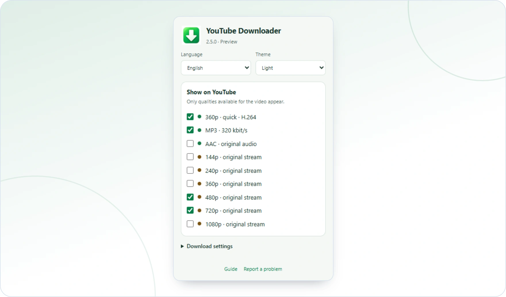

<!-- ppk-readme:head:start -->
<a href="https://popovantondev.github.io/YouTubeDownloader/index-en.html"><picture><source media="(prefers-color-scheme: dark)" srcset="https://raw.githubusercontent.com/popovantondev/YouTubeDownloader/main/docs/readme/header-en-dark.6f80db65.svg"></picture></a>
<!-- ppk-readme:head:end -->

# YouTube Downloader

[Русский](README.ru.md) · [Deutsch](README.md) · **English**

<!-- ppk-readme:body:start -->

<a href="https://github.com/popovantondev/YouTubeDownloader/releases/tag/v2.6.0"><picture><source media="(prefers-color-scheme: dark)" srcset="https://raw.githubusercontent.com/popovantondev/YouTubeDownloader/main/docs/readme/btn-download-en-dark.f8ce8eb1.svg"></picture></a>
<a href="https://popovantondev.github.io/YouTubeDownloader/index-en.html"><picture><source media="(prefers-color-scheme: dark)" srcset="https://raw.githubusercontent.com/popovantondev/YouTubeDownloader/main/docs/readme/btn-website-en-dark.5cf36359.svg"></picture></a>
<a href="https://popovantondev.github.io/YouTubeDownloader/Guide-en.html"><picture><source media="(prefers-color-scheme: dark)" srcset="https://raw.githubusercontent.com/popovantondev/YouTubeDownloader/main/docs/readme/btn-guide-en-dark.a026a2e7.svg"></picture></a>
<a href="https://github.com/popovantondev/YouTubeDownloader/issues/new/choose"><picture><source media="(prefers-color-scheme: dark)" srcset="https://raw.githubusercontent.com/popovantondev/YouTubeDownloader/main/docs/readme/btn-bug-en-dark.d1ad18c9.svg"></picture></a>

<a href="https://raw.githubusercontent.com/popovantondev/YouTubeDownloader/main/assets/screenshots/chrome-popup-en-light.png"><picture><source media="(prefers-color-scheme: dark)" srcset="https://raw.githubusercontent.com/popovantondev/YouTubeDownloader/main/docs/readme/preview-en-dark.daac4811.webp"></picture></a> 
<a href="https://raw.githubusercontent.com/popovantondev/YouTubeDownloader/main/assets/screenshots/chrome-popup-en-light.png">Full screenshot</a>

<picture><source media="(prefers-color-scheme: dark)" srcset="https://raw.githubusercontent.com/popovantondev/YouTubeDownloader/main/docs/readme/divider-dark.da40df51.svg"></picture>
<!-- ppk-readme:body:end -->

Download YouTube video and audio on Windows. Choose formats and visible download buttons in the browser extension.

<!-- public-release:start -->
**YouTube Downloader 2.6.0 Preview**

[Download Preview](https://github.com/popovantondev/YouTubeDownloader/releases/tag/v2.6.0) · [User guide](https://popovantondev.github.io/YouTubeDownloader/Guide-en.html) · [Report a problem](https://github.com/popovantondev/YouTubeDownloader/issues/new/choose)
<!-- public-release:end -->

## Install without administrator rights

Run YouTubeDownloader-PeakMP3-2.6.0-Preview-Setup.exe. The installer puts the desktop program, native host, extension files, media tools and offline guides into your user profile. Close PeakMP3 and ongoing downloads before upgrading. Browser connection remains a separate guided action in each browser profile.

## Connect a browser

In the connection wizard choose Chrome, Edge or Yandex and open its extension management page. Enable Developer mode, choose Load unpacked and select the extension folder shown by the wizard. Pin the green arrow. Refresh existing YouTube tabs. The popup should show PeakMP3 connected. Managed browser policies may prohibit unpacked extensions; the installer does not change them.

## Choose how to get MP3

The green MP3 button keeps its normal, unprocessed MP3 action. Its arrow opens two choices: download MP3 without processing, or download AAC and open PeakMP3. The second path copies original AAC to the private inbox, then opens it in PeakMP3 without autoplay. Listen, adjust density and export there. It does not silently produce a finished processed MP3. The save dialog starts at Desktop and lets you choose another location.

## Formats and language

The green browser arrow opens settings. Default visible formats are green quick 360p and MP3, brown original 480p and 720p. Other qualities and original AAC can be enabled there. Language RU/DE/EN and visibility are saved per browser profile. PeakMP3 has its own language selection; an incoming job sets the initial language only on first launch. Downloads default to without playback.

## Windows 7 and weak computers

Windows 7 SP1 32-bit with SSE2 remains a required target. Both managed applications target x86 .NET Framework 3.5 / CLR2; configurations allow CLR4 on newer Windows. FFmpeg is a static x86 MSVCRT build. No .NET 4.8, WebView2 or x64-only runtime is required. System Windows, a compatible browser and a usable .NET runtime are prerequisites. The installer does not enable Windows features. The user reports successful use on Windows 11 with current Chrome and on Windows 7 with the last compatible Yandex and Chrome (reported approximately as 109). Exact versions and complete installation/download/handoff/export scenarios were not recorded. This is a user report, separate from the local automated checks. Windows 10 has not been separately tested. See the checks file.

## Upgrade, recovery and uninstall

The existing extension ID, native host, install path, settings key and audio cache are retained. Setup snapshots the prior files and registrations before replacing them. Restore_previous.cmd restores BACKUP_PRE_260 when present. Uninstall through Windows Apps removes owned program files and registration, retaining settings, audio cache, inbox audio and downloads. Remove the extension separately from each browser profile. Do not manually delete user folders.

## Known limits and checks

YouTube can refuse original streams with attestation required. This version does not claim to fix that refusal and never switches to playback automatically. AAC handoff requires an accessible AAC source; Opus is not relabelled AAC. Test results are in docs/CHECKS-260.md. Synthetic media and simulated browser tests do not establish successful live downloads or every-browser compatibility.

## Sources and rights

SOURCE-KIT contains application sources, extension sources, build scripts and checks. Runtime FFmpeg and FFprobe are included. Matching FFmpeg/LAME source archives and build configuration are in encoder, with licenses in licenses. Own code may be inspected and the unmodified release used personally; third-party terms apply separately. See RIGHTS.md and THIRD_PARTY_NOTICES.md.

**[YouTube Downloader website](https://popovantondev.github.io/YouTubeDownloader/index-en.html)**

## One installer, two programs

The release v2.6.0 contains one shared installer, `YouTubeDownloader-PeakMP3-2.6.0-Preview-Setup.exe`. It installs two programs: **YouTube Downloader 2.6.0** (browser extension and native host) and **PeakMP3 0.16.0** (audio processing; it has its own repository and website). That is why the PeakMP3 download button points to this release.

The FFmpeg and LAME media tools are LGPL components. Their matching source code and build configuration are published as a separate file in the same release: [FFmpeg corresponding sources](https://github.com/popovantondev/YouTubeDownloader/releases/download/v2.6.0/YouTubeDownloader-2.6.0-FFmpeg-Corresponding-Sources.zip). Details: THIRD_PARTY_NOTICES.md.

[PeakMP3 audio processing](https://popovantondev.github.io/PeakMP3/index-en.html) · [PeakMP3 source code](https://github.com/popovantondev/PeakMP3)
