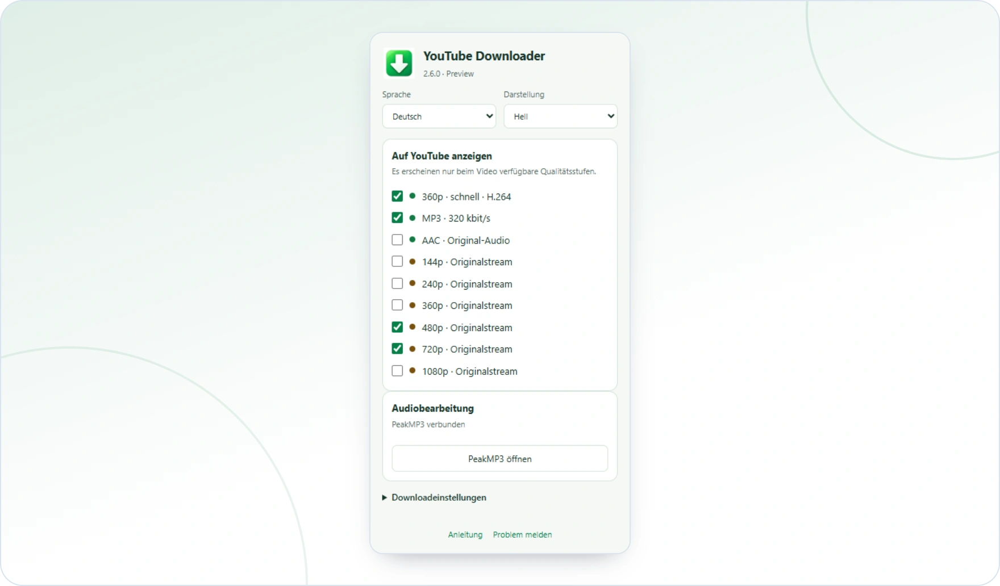

<!-- ppk-readme:head:start -->
<a href="https://popovantondev.github.io/YouTubeDownloader/index.html"><picture><source media="(prefers-color-scheme: dark)" srcset="https://raw.githubusercontent.com/popovantondev/YouTubeDownloader/main/docs/readme/header-de-dark.937a0a77.svg"></picture></a>
<!-- ppk-readme:head:end -->

# YouTube Downloader

[Русский](README.ru.md) · **Deutsch** · [English](README.en.md)

<!-- ppk-readme:body:start -->

<a href="https://github.com/popovantondev/YouTubeDownloader/releases/tag/v2.6.0"><picture><source media="(prefers-color-scheme: dark)" srcset="https://raw.githubusercontent.com/popovantondev/YouTubeDownloader/main/docs/readme/btn-download-de-dark.eb503dc1.svg"></picture></a>
<a href="https://popovantondev.github.io/YouTubeDownloader/index.html"><picture><source media="(prefers-color-scheme: dark)" srcset="https://raw.githubusercontent.com/popovantondev/YouTubeDownloader/main/docs/readme/btn-website-de-dark.7152b9fc.svg"></picture></a>
<a href="https://popovantondev.github.io/YouTubeDownloader/Guide-de.html"><picture><source media="(prefers-color-scheme: dark)" srcset="https://raw.githubusercontent.com/popovantondev/YouTubeDownloader/main/docs/readme/btn-guide-de-dark.038079c4.svg"></picture></a>
<a href="https://github.com/popovantondev/YouTubeDownloader/issues/new/choose"><picture><source media="(prefers-color-scheme: dark)" srcset="https://raw.githubusercontent.com/popovantondev/YouTubeDownloader/main/docs/readme/btn-bug-de-dark.60a74a84.svg"></picture></a>

<a href="https://raw.githubusercontent.com/popovantondev/YouTubeDownloader/main/assets/screenshots/chrome-popup-de-light.png"><picture><source media="(prefers-color-scheme: dark)" srcset="https://raw.githubusercontent.com/popovantondev/YouTubeDownloader/main/docs/readme/preview-de-dark.65929948.webp"></picture></a> 
<a href="https://raw.githubusercontent.com/popovantondev/YouTubeDownloader/main/assets/screenshots/chrome-popup-de-light.png">Ganzer Screenshot</a>

<picture><source media="(prefers-color-scheme: dark)" srcset="https://raw.githubusercontent.com/popovantondev/YouTubeDownloader/main/docs/readme/divider-dark.da40df51.svg"></picture>
<!-- ppk-readme:body:end -->

YouTube-Videos und Audio unter Windows herunterladen. Formate und sichtbare Schaltflächen lassen sich in der Browser-Erweiterung auswählen.

<!-- public-release:start -->
**YouTube Downloader 2.6.0 Preview**

[Preview herunterladen](https://github.com/popovantondev/YouTubeDownloader/releases/tag/v2.6.0) · [Anleitung](https://popovantondev.github.io/YouTubeDownloader/Guide-de.html) · [Problem melden](https://github.com/popovantondev/YouTubeDownloader/issues/new/choose)
<!-- public-release:end -->

## Ohne Administrator installieren

YouTubeDownloader-PeakMP3-2.6.0-Preview-Setup.exe starten. Das Paket installiert Desktopprogramm, lokalen Host, Erweiterungsdateien, Medienwerkzeuge und Offline-Anleitungen im Benutzerprofil. PeakMP3 und aktive Downloads vor einem Update schließen. Die Erweiterung wird je Browserprofil mit dem Assistenten verbunden.

## Browser verbinden

Chrome, Edge oder Yandex im Assistenten wählen und die Erweiterungsverwaltung öffnen. Entwicklermodus aktivieren, Entpackte Erweiterung laden wählen und den angezeigten Ordner extension auswählen. Grünen Pfeil anheften und YouTube-Tabs neu laden. Im Menü sollte PeakMP3 verbunden erscheinen. Organisationsrichtlinien können dies verbieten; das Setup verändert sie nicht.

## MP3 mit oder ohne Bearbeitung

Die grüne MP3-Taste lädt weiterhin MP3 ohne Bearbeitung. Der Pfeil daneben bietet zwei Wege: MP3 ohne Bearbeitung oder AAC laden und PeakMP3 öffnen. Beim zweiten Weg wird Original-AAC in den privaten Auftragseingang kopiert und ohne Autoplay geöffnet. Anhören, Dichte einstellen und im Programm speichern. Es entsteht nicht automatisch eine fertige bearbeitete MP3. Der Speicherdialog beginnt auf dem Desktop und erlaubt einen anderen Zielordner.

## Formate und Sprachen

Der grüne Browserpfeil öffnet die Einstellungen. Standardmäßig sichtbar: grünes schnelles 360p und MP3, braune Originalformate 480p und 720p. Andere Qualitäten und AAC lassen sich dort aktivieren. RU/DE/EN und Sichtbarkeit werden pro Browserprofil gespeichert. PeakMP3 hat eine eigene Sprachwahl; ein Auftrag bestimmt die Anfangssprache nur beim ersten Start. Standard ist Download ohne Wiedergabe.

## Windows 7 und schwache Rechner

Windows 7 SP1 32 Bit und SSE2 bleiben verbindliches Ziel. Beide Programme sind x86 .NET Framework 3.5 / CLR2 mit konfiguriertem CLR4-Fallback. FFmpeg ist statisch für x86/MSVCRT gebaut. Kein .NET 4.8, WebView2 oder reines x64-Laufzeitsystem nötig. Windows, kompatibler Browser und funktionsfähiges System-.NET sind Voraussetzungen. Das Setup aktiviert keine Windows-Features. Der Nutzer berichtet erfolgreiche Verwendung unter Windows 11 mit aktuellem Chrome und Windows 7 mit kompatiblem Yandex und Chrome (ungefähr 109). Exakte Versionen und die vollständige Testmatrix sind nicht dokumentiert. Windows 10 wurde nicht separat geprüft. Nutzerberichte und lokale Prüfungen sind getrennt aufgeführt.

## Update, Wiederherstellung, Entfernen

Erweiterungs-ID, Hostname, Installationspfad, Einstellungskennung und Audiocache bleiben erhalten. Vor dem Ersetzen werden Dateien und Registrierung gesichert. Restore_previous.cmd stellt BACKUP_PRE_260 wieder her, falls vorhanden. Die Windows-Deinstallation entfernt eigene Programmdateien und Registrierung; Einstellungen, Cache, eingegangene AAC-Dateien und Downloads bleiben erhalten. Erweiterung separat aus jedem Browserprofil entfernen.

## Grenzen und Prüfungen

YouTube kann Originalstreams mit attestation required ablehnen. Diese Version behauptet keine Behebung und startet keine Wiedergabe als Ersatz. AAC-Übergabe benötigt eine erreichbare AAC-Quelle; Opus wird nicht als AAC ausgegeben. Ergebnisse stehen in docs/CHECKS-260.md. Synthetische Medien und simulierte Browser-APIs beweisen keine erfolgreichen Live-Downloads oder allgemeine Browserkompatibilität.

## Quellen und Rechte

SOURCE-KIT enthält Programm- und Erweiterungsquellen, Buildskripte und Prüfungen. FFmpeg/FFprobe sind enthalten. Passende FFmpeg/LAME-Quellarchive und Konfiguration liegen unter encoder, Lizenzen unter licenses. Eigener Code dient der Einsicht; unveränderte Programme dürfen privat genutzt werden. Drittanbieterbedingungen gelten separat. Siehe RIGHTS.md und THIRD_PARTY_NOTICES.md.

**[YouTube-Downloader-Website](https://popovantondev.github.io/YouTubeDownloader/index.html)**

## Ein Installationspaket, zwei Programme

Das Release v2.6.0 enthält ein gemeinsames Setup, `YouTubeDownloader-PeakMP3-2.6.0-Preview-Setup.exe`. Es installiert zwei Programme: **YouTube Downloader 2.6.0** (Browser-Erweiterung und lokaler Host) und **PeakMP3 0.16.0** (Audiobearbeitung, mit eigenem Repository und eigener Website). Deshalb verweist der Download von PeakMP3 auf dieses Release.

Die Medienwerkzeuge FFmpeg und LAME stehen unter der LGPL. Ihr passender Quellcode samt Build-Konfiguration liegt als eigene Datei im selben Release: [FFmpeg-Quellcode](https://github.com/popovantondev/YouTubeDownloader/releases/download/v2.6.0/YouTubeDownloader-2.6.0-FFmpeg-Corresponding-Sources.zip). Einzelheiten: THIRD_PARTY_NOTICES.md.

[Audiobearbeitung mit PeakMP3](https://popovantondev.github.io/PeakMP3/index.html) · [PeakMP3-Quellcode](https://github.com/popovantondev/PeakMP3)
