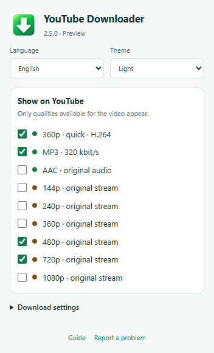

# YouTube Downloader

<!-- public-release:start -->
**YouTube Downloader 2.5.0 Preview**

[Download Preview](https://github.com/popovantondev/YouTubeDownloader/releases/tag/v2.5.0) · [User guide](https://popovantondev.github.io/YouTubeDownloader/Guide-en.html) · [Report a problem](https://github.com/popovantondev/YouTubeDownloader/issues/new/choose)
<!-- public-release:end -->

[English](https://github.com/popovantondev/YouTubeDownloader#readme) · [Русский](https://github.com/popovantondev/YouTubeDownloader/blob/main/docs/README.ru.md) · [Deutsch](https://github.com/popovantondev/YouTubeDownloader/blob/main/docs/README.de.md)

Save YouTube video and audio on Windows. Choose the buttons you want; download original streams while the video stays paused.

**Windows · x86/x64 · Preview 2.5.0 · RU / DE / EN**

Preview limitation: YouTube may require session verification (attestation required) and stop an original-quality download. No playback fallback or complete-download guarantee is provided.

[Download Preview 2.5.0](https://github.com/popovantondev/YouTubeDownloader/releases/tag/v2.5.0) · [User guide](https://popovantondev.github.io/YouTubeDownloader/Guide-en.html) · [Report a problem](https://github.com/popovantondev/YouTubeDownloader/issues/new/choose)

Actual extension page in Chrome 155 with demonstration settings; automated UI check, not a download or a Windows 7 test.

## Installation

1. Extract the entire release ZIP to a writable folder. Check SHA256SUMS.txt. Browser, Windows and the system .NET runtime are prerequisites.
2. Close YouTube tabs and run Install.cmd normally, without administrator rights. Optional language: Install.cmd en, ru or de.
3. Open edge://extensions, chrome://extensions or browser://extensions. Enable Developer mode and choose Load unpacked.
4. Select %LOCALAPPDATA%\YTWin7_360_MP3\extension. For an existing installation, reload the extension and YouTube page.
5. Pin the green arrow icon to the toolbar. Click it to choose language, theme and visible formats. Start with 480p.

## A compact panel

Green: quick H.264 360p, MP3 and original AAC. Brown: original video qualities. By default, only 360p, MP3, 480p and 720p appear. Configure everything from the browser toolbar icon.

## Without playback

The browser downloads media in the background; the page stays paused. Video and AAC are copied without re-encoding. MP3 320 kbit/s is converted audio and cannot improve its source.

## Designed for Windows 7

Originally created for Windows 7 and low-powered computers. The native component targets .NET Framework 3.5 / CLR2, with configured CLR4 fallback for modern Windows. Windows 10/11 and compatible older/newer Chromium browsers are intended targets; see the exact test matrix.

## Compatibility and checks

2.5.0 on Windows 11: Chrome 155.0.8059.80 and Edge 155.0.4283.45 passed menu/settings tests and actual Native Messaging registration/host communication in isolated browser profiles. A staged current-user install, upgrade from 2.4.2, restore and integration removal passed. Local media tests cover 144–1080p, AAC, Opus and MP3 with packet preservation checks. The live Edge 480p attempt stopped on YouTube session verification; a complete live download is not confirmed in that test. Fresh Windows 7, Windows 10 and current Yandex have not been independently tested with 2.5.0. The earlier 2.4.2 was reported working on reset Windows 7 with Yandex 24.10.4.850 and on Windows 11.

## Limitations

Preview: YouTube can change delivery protocols or reject a stream. Supported choices are 144–1080p; only available qualities appear. Live streams, playlists, DRM, Vimeo and other sites are not supported. Signed URLs may expire; autonomous token refresh is not implemented. A 320 kbit/s MP3 is not higher-quality than its source. The release is unsigned.

## Files and removal

Original-quality MP4, MP3 and AAC/M4A are saved on Desktop. Quick 360p uses the browser download destination. Audio cache and temporary files use LocalAppData. Uninstall.cmd removes only browser integration; downloads, cache and application files are preserved. Remove the extension separately from the browser.

## Rights and components

Application source is published for educational and portfolio inspection, not under an open-source license. Individuals may run an unmodified released binary for personal use. FFmpeg, LAME, googlevideo and protobuf retain separate licenses and corresponding-source provisions. See RIGHTS.md and THIRD_PARTY_NOTICES.md.

Upgrade recovery: the first existing installation is backed up with its extension, native component, FFmpeg/FFprobe and registration under %LOCALAPPDATA%\YTWin7_WatchCapture\BACKUP_PRE_250. Close YouTube tabs, run Restore_previous.cmd from this kit and reload the extension to restore it. A failed installation attempts to restore its own transaction snapshot. Uninstall.cmd preserves application files and audio cache.
