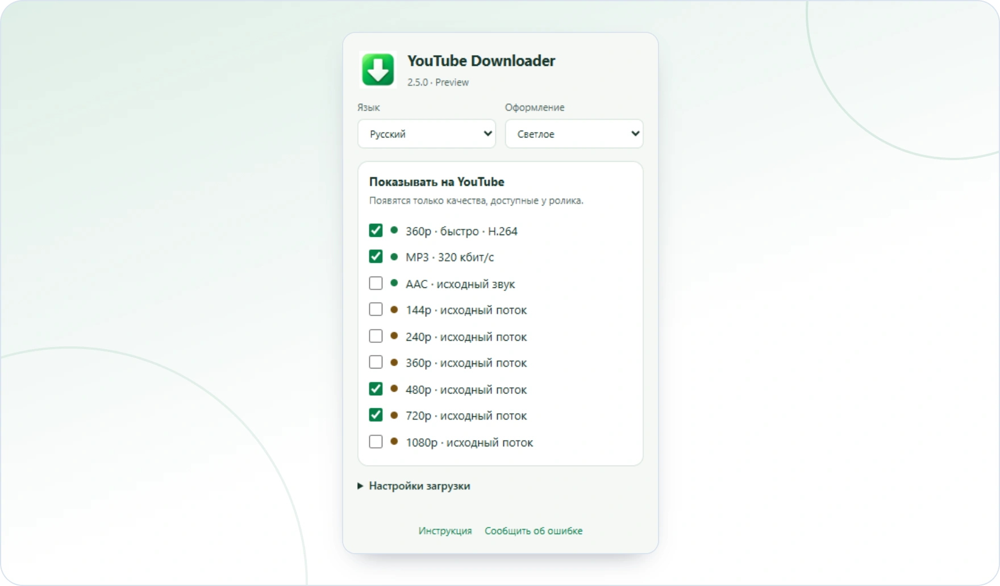

<!-- ppk-readme:head:start -->
<a href="https://popovantondev.github.io/YouTubeDownloader/index-ru.html"><picture><source media="(prefers-color-scheme: dark)" srcset="https://raw.githubusercontent.com/popovantondev/YouTubeDownloader/main/docs/readme/header-ru-dark.5c7e8b8b.svg"></picture></a>
<!-- ppk-readme:head:end -->

# YouTube Downloader

**Русский** · [Deutsch](README.md) · [English](README.en.md)

<!-- ppk-readme:body:start -->

<a href="https://github.com/popovantondev/YouTubeDownloader/releases/tag/v2.6.0"><picture><source media="(prefers-color-scheme: dark)" srcset="https://raw.githubusercontent.com/popovantondev/YouTubeDownloader/main/docs/readme/btn-download-ru-dark.9793cecd.svg"></picture></a>
<a href="https://popovantondev.github.io/YouTubeDownloader/index-ru.html"><picture><source media="(prefers-color-scheme: dark)" srcset="https://raw.githubusercontent.com/popovantondev/YouTubeDownloader/main/docs/readme/btn-website-ru-dark.9a0b9e6c.svg"></picture></a>
<a href="https://popovantondev.github.io/YouTubeDownloader/Guide-ru.html"><picture><source media="(prefers-color-scheme: dark)" srcset="https://raw.githubusercontent.com/popovantondev/YouTubeDownloader/main/docs/readme/btn-guide-ru-dark.e0e81c95.svg"></picture></a>
<a href="https://github.com/popovantondev/YouTubeDownloader/issues/new/choose"><picture><source media="(prefers-color-scheme: dark)" srcset="https://raw.githubusercontent.com/popovantondev/YouTubeDownloader/main/docs/readme/btn-bug-ru-dark.987a1f79.svg"></picture></a>

<a href="https://raw.githubusercontent.com/popovantondev/YouTubeDownloader/main/assets/screenshots/chrome-popup-ru-light.png"><picture><source media="(prefers-color-scheme: dark)" srcset="https://raw.githubusercontent.com/popovantondev/YouTubeDownloader/main/docs/readme/preview-ru-dark.fa1c2b06.webp"></picture></a> 
<a href="https://raw.githubusercontent.com/popovantondev/YouTubeDownloader/main/assets/screenshots/chrome-popup-ru-light.png">Снимок целиком</a>

<picture><source media="(prefers-color-scheme: dark)" srcset="https://raw.githubusercontent.com/popovantondev/YouTubeDownloader/main/docs/readme/divider-dark.da40df51.svg"></picture>
<!-- ppk-readme:body:end -->

Загрузка видео и аудио с YouTube для Windows. Форматы и видимость кнопок выбираются в расширении браузера.

<!-- public-release:start -->
**YouTube Downloader 2.6.0 Preview**

[Скачать Preview](https://github.com/popovantondev/YouTubeDownloader/releases/tag/v2.6.0) · [Инструкция](https://popovantondev.github.io/YouTubeDownloader/Guide-ru.html) · [Сообщить об ошибке](https://github.com/popovantondev/YouTubeDownloader/issues/new/choose)
<!-- public-release:end -->

## Установка без администратора

Запустите YouTubeDownloader-PeakMP3-2.6.0-Preview-Setup.exe. Он устанавливает программу, локальный компонент, файлы расширения, FFmpeg и офлайн-инструкции в профиль пользователя. Перед обновлением закройте PeakMP3 и активные загрузки. Расширение подключается через мастер отдельно в каждом профиле браузера.

## Подключение браузера

Выберите Chrome, Edge или Яндекс в мастере и откройте управление расширениями. Включите режим разработчика, нажмите «Загрузить распакованное расширение» и укажите папку extension, показанную мастером. Закрепите зелёную стрелку. Обновите вкладки YouTube. В меню должна появиться связь с PeakMP3. Политики организации могут запрещать такие расширения; установщик их не меняет.

## MP3 с обработкой и без

Обычное нажатие зелёной MP3 сохраняет MP3 без обработки. Стрелка рядом открывает два варианта: скачать MP3 без обработки или скачать AAC и открыть PeakMP3. Во втором случае исходный AAC копируется в личную папку заданий и открывается в программе без автозапуска. Прослушайте, настройте плотность и сохраните MP3. Готовый обработанный MP3 автоматически не создаётся. Окно сохранения начинается с рабочего стола и позволяет выбрать другую папку.

## Форматы и языки

Зелёная стрелка браузера открывает настройки. По умолчанию видны зелёные быстрый 360p и MP3, коричневые исходные 480p и 720p. Остальные качества и AAC включаются в меню. Язык RU/DE/EN и видимость сохраняются для профиля браузера. Язык PeakMP3 выбирается отдельно; входящее задание задаёт начальный язык только при первом запуске. По умолчанию скачивание без просмотра.

## Windows 7 и слабый компьютер

Обязательная цель — Windows 7 SP1 32 бита и процессор с SSE2. Программы собираются как x86 .NET Framework 3.5 / CLR2, с запуском через CLR4 на новых Windows. FFmpeg статический x86 MSVCRT. .NET 4.8, WebView2 и среда только x64 не требуются. Windows, совместимый браузер и работающий системный .NET нужны отдельно. Установщик не включает компоненты Windows. Пользователь сообщил об успешной работе на Windows 11 с актуальным Chrome и Windows 7 с последним совместимым Яндексом и Chrome (предположительно 109). Точные версии и полный набор сценариев установки, загрузки, передачи AAC и экспорта не зафиксированы. Это сообщение пользователя, отдельно от локальных автоматизированных проверок. Windows 10 отдельно не проверялась; результаты перечислены отдельно.

## Обновление, восстановление и удаление

Сохраняются ID расширения, имя локального компонента, пути установки и кэша, ключ настроек. Перед заменой установщик копирует прежние файлы и регистрацию. Restore_previous.cmd восстанавливает BACKUP_PRE_260, если он существует. Удаление через приложения Windows убирает собственные файлы и регистрацию, сохраняя настройки, аудиокэш, входящие AAC и скачанные файлы. Расширение удаляется отдельно из каждого профиля браузера. Пользовательские папки вручную удалять не нужно.

## Ограничения и проверки

YouTube может отказать с attestation required. Эта версия не заявляет исправление отказа и не включает видео автоматически. Для передачи нужен доступный исходный AAC; Opus не выдаётся за AAC. Результаты — docs/CHECKS-260.md. Синтетические образцы и имитация API браузера не подтверждают успешную живую загрузку или работу всех браузеров.

## Исходники и права

В SOURCE-KIT находятся исходники приложения и расширения, сборка и проверки. FFmpeg и FFprobe включены. Соответствующие исходники FFmpeg/LAME и параметры сборки — encoder, лицензии — licenses. Собственный код доступен для ознакомления, неизменённый выпуск — для личного использования; сторонние лицензии действуют отдельно. См. RIGHTS.md и THIRD_PARTY_NOTICES.md.

**[Сайт YouTube Downloader](https://popovantondev.github.io/YouTubeDownloader/index-ru.html)**

## Один установщик, две программы

В релизе v2.6.0 один общий установщик `YouTubeDownloader-PeakMP3-2.6.0-Preview-Setup.exe`. Он ставит две программы: **YouTube Downloader 2.6.0** (расширение браузера и локальный компонент) и **PeakMP3 0.16.0** (обработка звука, свой репозиторий и свой сайт). Поэтому загрузка PeakMP3 ведёт на этот релиз.

Медиаинструменты FFmpeg и LAME распространяются по LGPL. Соответствующий исходный код и параметры сборки лежат отдельным файлом в том же релизе: [исходники FFmpeg](https://github.com/popovantondev/YouTubeDownloader/releases/download/v2.6.0/YouTubeDownloader-2.6.0-FFmpeg-Corresponding-Sources.zip). Подробнее: THIRD_PARTY_NOTICES.md.

[Аудиообработка PeakMP3](https://popovantondev.github.io/PeakMP3/index-ru.html) · [Исходники PeakMP3](https://github.com/popovantondev/PeakMP3)
