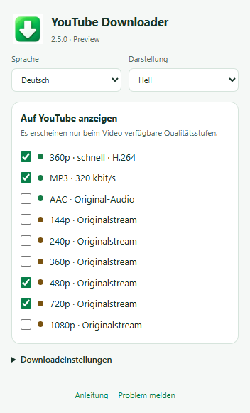

# YouTube Downloader

<!-- public-release:start -->
**YouTube Downloader 2.5.0 Preview**

[Preview herunterladen](https://github.com/popovantondev/YouTubeDownloader/releases/tag/v2.5.0) · [Anleitung](https://popovantondev.github.io/YouTubeDownloader/Guide-de.html) · [Problem melden](https://github.com/popovantondev/YouTubeDownloader/issues/new/choose)
<!-- public-release:end -->

[English](https://github.com/popovantondev/YouTubeDownloader#readme) · [Русский](https://github.com/popovantondev/YouTubeDownloader/blob/main/docs/README.ru.md) · [Deutsch](https://github.com/popovantondev/YouTubeDownloader/blob/main/docs/README.de.md)

YouTube-Videos und Audio unter Windows speichern. Gewünschte Schaltflächen wählen und Originalstreams laden, während das Video pausiert bleibt.

**Windows · x86/x64 · Preview 2.5.0 · RU / DE / EN**

Preview-Einschränkung: YouTube kann eine Sitzungsbestätigung verlangen (attestation required) und den Originaldownload abbrechen. Kein automatischer Wiedergabemodus und keine Garantie vollständiger Downloads.

[Preview 2.5.0 herunterladen](https://github.com/popovantondev/YouTubeDownloader/releases/tag/v2.5.0) · [Anleitung](https://popovantondev.github.io/YouTubeDownloader/Guide-de.html) · [Problem melden](https://github.com/popovantondev/YouTubeDownloader/issues/new/choose)

Tatsächliche Erweiterungsseite in Chrome 155 mit Beispieleinstellungen. Menüprüfung, kein Download- oder Windows-7-Test.

## Installation

1. Gesamtes Release-ZIP in einen beschreibbaren Ordner entpacken. SHA256SUMS.txt prüfen. Browser, Windows und System-.NET werden separat vorausgesetzt.
2. YouTube-Tabs schließen und Install.cmd normal ohne Administratorrechte starten. Optionale Sprache: Install.cmd de, ru oder en.
3. edge://extensions, chrome://extensions oder browser://extensions öffnen. Entwicklermodus aktivieren und „Entpackte Erweiterung laden“ wählen.
4. %LOCALAPPDATA%\YTWin7_360_MP3\extension auswählen. Bei Updates Erweiterung und YouTube-Seite neu laden.
5. Grünen Pfeil in der Browserleiste anheften. Darüber Sprache, Darstellung und sichtbare Formate wählen. Zuerst 480p versuchen.

## Kompakte Leiste

Grün: schnelles H.264-360p, MP3 und Original-AAC. Braun: Original-Videoqualität. Standardmäßig erscheinen 360p, MP3, 480p und 720p. Einstellungen über das Symbol in der Browserleiste.

## Ohne Wiedergabe

Der Browser lädt Medien im Hintergrund; die Seite bleibt pausiert. Video und AAC werden ohne Neukodierung gespeichert. MP3 mit 320 kbit/s ist umgewandeltes Audio und verbessert die Quelle nicht.

## Für Windows 7 entwickelt

Ursprünglich für Windows 7 und schwache Rechner entwickelt. Die lokale Komponente zielt auf .NET Framework 3.5 / CLR2; für moderne Windows-Versionen ist CLR4-Fallback konfiguriert. Auch Windows 10/11 und kompatible ältere/neuere Chromium-Browser sind vorgesehen. Tatsächliche Tests sind getrennt aufgeführt.

## Kompatibilität und Tests

2.4.2: Nutzer bestätigte Funktion auf zurückgesetztem Windows 7 mit Yandex 24.10.4.850 sowie Windows 11; Dateien wurden unabhängig dekodiert. 2.5.0: Chrome 155.0.8059.80 und Edge 155.0.4283.45 bestanden automatisierte Erweiterungs-/Einstellungstests mit künstlichen Videometadaten. Native Tests: docs/TEST_RESULTS.md. Saubere 2.5.0-Installation, Windows 10 und aktuelles Yandex sind noch nicht unabhängig geprüft.

## Einschränkungen

Preview: YouTube kann Protokolle ändern oder Streams ablehnen. Auswahl 144–1080p; nur verfügbare Qualitäten erscheinen. Livestreams, Playlists, DRM, Vimeo und andere Seiten werden nicht unterstützt. Signierte Adressen können ablaufen; eigenständige Token-Erneuerung fehlt noch. MP3 320 verbessert die Quelle nicht. EXE unsigniert.

## Dateien und Entfernung

Original-MP4, MP3 und AAC/M4A werden auf dem Desktop gespeichert. Schnelles 360p nutzt den Browser-Downloadordner. Audiocache und temporäre Dateien liegen in LocalAppData. Uninstall.cmd entfernt nur die Browserintegration; Downloads, Cache und Programmdateien bleiben erhalten. Erweiterung separat im Browser entfernen.

## Rechte und Komponenten

Eigener Quelltext dient der Einsicht als Lern- und Portfolioprojekt, ohne Open-Source-Lizenz. Unveränderte veröffentlichte Programme dürfen privat ausgeführt werden. FFmpeg, LAME, googlevideo und protobuf behalten separate Lizenzen und Quelltextbedingungen. Siehe RIGHTS.md und THIRD_PARTY_NOTICES.md.

Wiederherstellung nach Upgrade: Die erste vorhandene Installation wird mit Erweiterung, lokaler Komponente, FFmpeg/FFprobe und Registrierung unter %LOCALAPPDATA%\YTWin7_WatchCapture\BACKUP_PRE_250 gesichert. YouTube-Tabs schließen, Restore_previous.cmd aus diesem Paket starten und Erweiterung neu laden. Bei Installationsfehlern wird die jeweilige Transaktionskopie wiederhergestellt. Uninstall.cmd erhält Programmdateien und Audiocache.
