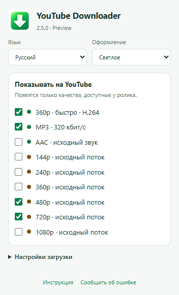

# YouTube Downloader

<!-- public-release:start -->
**YouTube Downloader 2.5.0 Preview**

[Скачать Preview](https://github.com/popovantondev/YouTubeDownloader/releases/tag/v2.5.0) · [Инструкция](https://popovantondev.github.io/YouTubeDownloader/Guide-ru.html) · [Сообщить об ошибке](https://github.com/popovantondev/YouTubeDownloader/issues/new/choose)
<!-- public-release:end -->

[English](https://github.com/popovantondev/YouTubeDownloader#readme) · [Русский](https://github.com/popovantondev/YouTubeDownloader/blob/main/docs/README.ru.md) · [Deutsch](https://github.com/popovantondev/YouTubeDownloader/blob/main/docs/README.de.md)

Загрузка видео и звука YouTube в Windows. Оставь нужные кнопки и сохраняй исходные потоки, пока видео стоит на паузе.

**Windows · x86/x64 · Preview 2.5.0 · RU / DE / EN**

Ограничение Preview: YouTube может потребовать подтверждение сеанса (attestation required) и остановить загрузку исходного качества. Автоматического перехода к просмотру нет; загрузка целого ролика не гарантируется.

[Скачать Preview 2.5.0](https://github.com/popovantondev/YouTubeDownloader/releases/tag/v2.5.0) · [Инструкция](https://popovantondev.github.io/YouTubeDownloader/Guide-ru.html) · [Сообщить об ошибке](https://github.com/popovantondev/YouTubeDownloader/issues/new/choose)

Настоящий интерфейс расширения в Chrome 155 с демонстрационными настройками. Проверка меню, а не загрузки или Windows 7.

## Установка

1. Распакуйте весь ZIP выпуска в доступную для записи папку. Проверьте SHA256SUMS.txt. Браузер, Windows и системный .NET устанавливаются отдельно.
2. Закройте вкладки YouTube и обычным запуском откройте Install.cmd, без администратора. Язык можно задать: Install.cmd ru, de или en.
3. Откройте edge://extensions, chrome://extensions или browser://extensions. Включите режим разработчика и выберите «Загрузить распакованное расширение».
4. Укажите %LOCALAPPDATA%\YTWin7_360_MP3\extension. При обновлении перезагрузите расширение и страницу YouTube.
5. Закрепите зелёную стрелку в панели браузера. По ней открываются язык, тема и показ форматов. Начните с 480p.

## Компактная панель

Зелёные: быстрый H.264 360p, MP3 и исходный AAC. Коричневые: исходные качества видео. По умолчанию видны 360p, MP3, 480p и 720p. Всё настраивается по значку в панели браузера.

## Без просмотра

Браузер получает данные в фоне, страница остаётся на паузе. Видео и AAC сохраняются без перекодирования. MP3 320 кбит/с — преобразованный звук, его качество ограничено источником.

## Создан для Windows 7

Первоначально создан для Windows 7 и слабых компьютеров. Локальный компонент использует .NET Framework 3.5 / CLR2; для современных Windows предусмотрен запуск через CLR4. Рассчитан также на Windows 10/11 и совместимые старые/новые Chromium-браузеры. Реальные проверки перечислены отдельно.

## Совместимость и проверки

2.5.0 на Windows 11: Chrome 155.0.8059.80 и Edge 155.0.4283.45 прошли проверки меню, настроек и настоящей связи с локальным компонентом через регистрацию Native Messaging в отдельных профилях. Проверены установка для текущего пользователя в отдельную папку, обновление 2.4.2, восстановление и удаление интеграции. Локальные медиатесты охватывают 144–1080p, AAC, Opus и MP3 с проверкой сохранности пакетов. Пробная загрузка 480p в Edge остановилась на подтверждении сеанса YouTube; целый ролик в этом тесте не получен. Новая чистая Windows 7, Windows 10 и актуальный Яндекс с 2.5.0 отдельно ещё не проверены. Для прежней 2.4.2 подтверждена пользователем работа на сброшенной Windows 7 с Яндексом 24.10.4.850 и Windows 11.

## Ограничения

Предварительный выпуск: YouTube может изменить протоколы или отказать в потоке. Выбор 144–1080p; появляются только доступные качества. Прямые эфиры, плейлисты, DRM, Vimeo и другие сайты не поддерживаются. Подписанные ссылки могут истекать, самостоятельного обновления токенов пока нет. MP3 320 не улучшает исходник. EXE без цифровой подписи.

## Файлы и удаление

Исходные MP4, MP3 и AAC/M4A сохраняются на рабочем столе. Быстрый 360p — в папку загрузок браузера. Кэш звука и временные файлы находятся в LocalAppData. Uninstall.cmd удаляет только интеграцию с браузерами, сохраняя загрузки, кэш и файлы программы. Само расширение удаляется в браузере отдельно.

## Права и компоненты

Собственные исходники опубликованы для ознакомления как учебный проект и портфолио, не под открытой лицензией. Неизменённый выпуск разрешается запускать для личного использования. FFmpeg, LAME, googlevideo и protobuf сохраняют отдельные лицензии и условия предоставления исходников. См. RIGHTS.md и THIRD_PARTY_NOTICES.md.

Восстановление после обновления: первая прежняя установка вместе с расширением, локальным компонентом, FFmpeg/FFprobe и регистрацией сохраняется в %LOCALAPPDATA%\YTWin7_WatchCapture\BACKUP_PRE_250. Закройте вкладки YouTube, запустите Restore_previous.cmd из комплекта и перезагрузите расширение. При сбое установки выполняется попытка вернуть снимок этой операции. Uninstall.cmd сохраняет файлы программы и аудиокэш.
